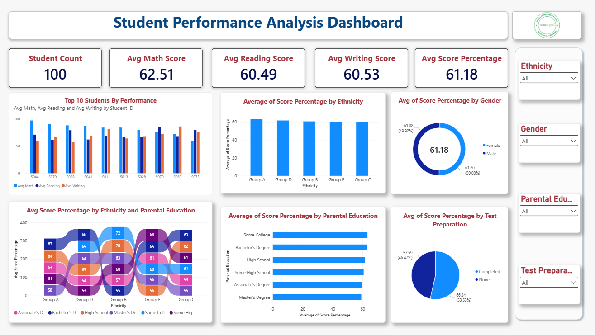

# Syntecxhub Student Performance Analysis

A simple, interactive **Power BI** dashboard that analyses how 100 students performed in Math, Reading, and Writing exams, and how their results relate to gender, ethnicity group, parental education, and test preparation.

## Dashboard Preview



The full dashboard is also available as a PDF: [Syntecxhub_Student_Performance_Analysis.pdf](Syntecxhub_Student_Performance_Analysis.pdf)

---

## Dataset

**Source:** [Students Performance in Exams dataset for Power BI (colorstech.net)](https://colorstech.net/power-bi/students-performance-in-exams-dataset-for-power-bi/)

This is a practice dataset for learning Power BI; meaning it is sample data. It contains **100 students** with these fields used in the dashboard:

| Field | Description |
|---|---|
| Student ID | Unique ID for each student (for example, S044) |
| Gender | Female or Male |
| Ethnicity | Group A, B, C, D, or E |
| Parental Education | Highest education level of the student's parents |
| Test Preparation | Whether the student completed a test preparation course (Completed or None) |
| Math Score, Reading Score, Writing Score | Exam scores, each out of 100 |

The raw dataset is stored unchanged in the `Raw_Data` folder.

---

## What Was Done

1. **Loaded** the dataset into Power BI Desktop.
2. **Checked data quality** in Power Query: missing values, duplicate rows, and data types.
3. **Created one calculated column**, `Score Percentage`, which combines the three exam scores into a single percentage:

```dax
Score Percentage =
DIVIDE ( [Math Score] + [Reading Score] + [Writing Score], 300, 0 ) * 100
```

The three scores add up to a maximum of 300, so dividing by 300 and multiplying by 100 gives each student's overall result as a percentage.

4. **Built the dashboard** with KPI cards, charts, and slicers.
5. **Exported** the dashboard as a PDF.

---

## KPIs

| KPI | Value | What it means |
|---|---|---|
| **Student Count** | 100 | Number of students in the dataset |
| **Avg Math Score** | 62.51 | Average Math score |
| **Avg Reading Score** | 60.49 | Average Reading score |
| **Avg Writing Score** | 60.53 | Average Writing score |
| **Avg Score Percentage** | 61.18 | Average overall result across all three subjects |

**Reading the KPIs:** Students scored a little above 61% overall. Math is the strongest subject, and Reading and Writing are almost identical.

---

## Visuals and What They Show

### 1. Top 10 Students by Performance (clustered column chart)
Shows the average Math, Reading, and Writing scores of ten high-performing students (S044, S079, S098, and so on).
- **What it shows:** the top students score close to or above 80 in at least one subject. S044 has the highest Math score (about 97).
- **What it means:** strong students are not always strong in every subject. For example, S044 is excellent at Math but noticeably lower in Writing (around 60), while S069 and S073 do better in Writing or Reading than in Math.

### 2. Average Score Percentage by Ethnicity (column chart)
Compares the overall score of the five ethnicity groups.
- **What it shows:** Group A is highest (roughly 63 to 64), and Groups C and E are lowest (roughly 60).
- **What it means:** The differences between groups are small (about 3 to 4 points), and with only 100 students, each group is small, so this should not be treated as a strong pattern.

### 3. Average Score Percentage by Gender (donut chart)
Compares female and male students.
- **What it shows:** Female 61.26 and Male 61.08, a difference of only 0.18 points.
- **What it means:** gender makes almost no difference to overall performance in this data. (The percentages on the donut only show each group's share of the combined average, so they will always be close to 50%.)

### 4. Average Score Percentage by Parental Education (bar chart)
Compares students by their parents' education level.
- **What it shows:** "Some College" and "Bachelor's Degree" are highest (about 63), while "Master's Degree" is lowest (about 59 to 60).
- **What it means:** There is no clear link between parental education and results. Higher parental education does not lead to higher scores here, and the small number of students in each level makes the differences unreliable.

### 5. Average Score Percentage by Test Preparation (pie chart)
Compares students who completed a test preparation course with those who did not.
- **What it shows:** Completed = **66.34**, None = **57.59**, a gap of about **8.75 points**.
- **What it means:** This is the largest difference in the whole dashboard. Students who completed test preparation scored clearly higher than those who did not.

### 6. Average Score Percentage by Ethnicity and Parental Education (ribbon chart)
Combines ethnicity group and parental education in one chart.
- **What it shows:** scores range from about **53** to **72** across the combinations. The highest value is Group B with "Some College" parents (72), and the lowest is Group D with "Some High School" parents (53).
- **What it means:** Results vary more when the two factors are combined, but each combination contains only a few students, so these values are noisy and should be read with care.

### Slicers
Four slicers (**Ethnicity, Gender, Parental Education, Test Preparation**) filter every KPI and chart at once, so any student group can be explored.

---

## Conclusions

- **Overall performance is moderate.** The average score is 61.18%, with Math (62.51) slightly ahead of Reading (60.49) and Writing (60.53).
- **Test preparation matters most.** Students who completed the course scored about 8.75 points higher than those who did not. This is the clearest finding, and it suggests encouraging students to take preparation courses.
- **Gender has almost no effect** (61.26 vs 61.08).
- **Ethnicity differences are small**, with Group A highest and Groups C and E lowest.
- **Parental education shows no clear pattern.** Students with parents who have a master's degree scored lowest, meaning other factors matter more.
- **Top students have different strengths.** High overall performers often excel in one subject rather than all three.

### Limitations
- The dataset has only **100 students**, so group-level differences (ethnicity, parental education) are based on very few students and may be due to chance.
- The dashboard shows **associations, not causes**. For example, students who prepare for tests may also differ in other ways.
- This is a practice dataset, so the results illustrate dashboard-building and analysis, not real student data.

---

## Tools Used

| Tool | Use |
|---|---|
| Power BI Desktop | Dashboard design and visuals |
| Power Query | Loading the data and checking quality |
| DAX | Creating the `Score Percentage` column |

---

## Project Structure

```
Syntecxhub_Student_Performance_Analysis
│
├── Raw_Data
│   └── <dataset file>.csv
│
├── PowerBI
│   └── <your report name>.pbix
│
├── Student_Performance_Dashboard.png
│
├── Syntecxhub_Student_Performance_Analysis.pdf
└── README.md
```

---

## How to Use

1. Download or clone the repository.
2. Open the `.pbix` file in **Power BI Desktop**.
3. Use the slicers on the right to filter the dashboard.

The report uses data stored inside the file, so no database or extra setup is needed.
